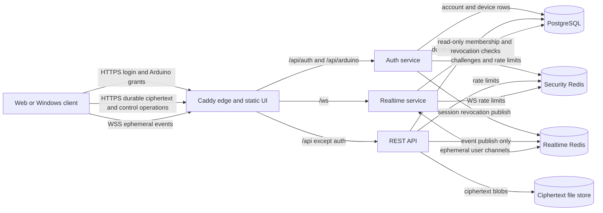

# AKFES Architecture

## Product purpose

AKFES is a cross-platform secure messenger. Ordinary conversation must remain
usable from the web and Windows client, while secret content can opt into an
Arduino-backed local approval step. The service relays ciphertext and delivery
metadata; plaintext and long-term E2EE private keys remain on user devices.

The architecture therefore optimizes for four invariants:

1. one protocol and one UI source serve web and desktop;
2. server components receive only the minimum credentials and database rights
   needed for their role;
3. durable writes use authenticated REST endpoints, while WebSocket carries
   only bounded realtime notifications and signed call signalling;
4. optional hardware protection cannot make ordinary account login or normal
   chat unavailable.

## Current-to-target comparison

| Concern | Earlier structure | Target structure now enforced |
| --- | --- | --- |
| Web client | React client plus a separate `server-source/web-src` client and legacy generated files | `client-source/client` is the only UI source; `server-source/web` is generated output only |
| Release entry point | Full, server-only, and secret-chat wrappers could package different trees | `AKFES_RELEASE.ps1` is the single entry point; server-only mode still rebuilds the canonical web client |
| Static deployment | New hashed assets were copied over old assets | Build and server install mirror the new output and delete superseded files |
| Authentication | Dedicated auth profile with JWT private key and Arduino verifier | Unchanged; private signing and physical-auth secrets remain isolated |
| REST/message API | General API also accepted WebSocket connections | General API owns durable ciphertext, file, profile, device, social and admin operations only |
| Realtime | Read-only Node2 credentials existed but no service used them | Dedicated `realtime` profile owns `/ws`, has read-only DB grants and no file/JWT-signing/Arduino capability |
| Redis | API could publish and subscribe to realtime channels | API only publishes; realtime node publishes ephemeral signals and subscribes for delivery |
| Request metadata | Uvicorn and Caddy retained general access logs; rate-limit keys contained identifiers | Access logs are disabled and rate-limit identifiers are HMAC-obscured; explicit security audits remain |

## Runtime architecture

## Principal data flows

### Login and device trust

The client unlocks its local crypto profile, proves possession of the device
key, and sends credentials to the auth service. The auth service alone verifies
passwords, issues JWTs, and validates Arduino actions. Other services receive
only the JWT public key.

### Message send and receive

The client obtains recipient device prekeys, encrypts one envelope per approved
device, and commits the batch through the REST API. The API stores ciphertext,
then publishes a notification. The realtime service delivers the notification;
clients recover missed events by reading durable conversation state after
reconnect. WebSocket cannot write messages.

### Secret content

Secret-message wrapping is a client capability layered above E2EE. Windows can
provision firmware and keypad settings; supported browsers can use an already
configured Arduino through Web Serial. The server receives neither the PIN nor
plaintext media.

## Code ownership boundaries

- `client-source/client/src`: presentation and application orchestration.
- `client-source/client/src/crypto.ts`: platform-neutral crypto port.
- `client-source/client/src/web-crypto.ts`: browser crypto adapter.
- `client-source/client/src-tauri`: Windows secure-storage, Arduino and native
  crypto adapter.
- `client-source/akfes-core`: reusable Rust E2EE primitives.
- `server-source/server/app/routers`: transport validation only.
- `server-source/server/app/services`: authorization and state-transition
  policy shared by transports.
- `server-source/deploy`: runtime privilege boundaries and release validation.

## Removed components

- `server-source/web-src`: duplicate legacy browser client.
- legacy `server-source/web/app.js`, `styles.css`, and `web-crypto.js`.
- `AKFES_SECRET_CHAT_RELEASE.ps1`: referenced obsolete source directory names.
- `PACKAGE_AND_DEPLOY_AKFES_SERVER.ps1`: could deploy a stale web build.
- general Caddy request access history containing raw client IP metadata.

## Remaining structural work

The next safe refactor is internal and protocol-preserving:

- split the large React `App.tsx` into session, realtime, conversation,
  composer, device-trust and secret-content application modules;
- split the large Tauri command module into credential-store, E2EE, Arduino and
  command-registration modules without changing its ACL;
- replace hand-maintained TypeScript/Python wire shapes with generated contract
  tests or a shared versioned schema;
- replace conversation-list N+1 database reads with bounded aggregate queries;
- add integration tests that launch auth, API and realtime profiles with their
  production database grants and prove forbidden writes fail.

Those changes should be delivered independently from protocol changes so each
can be rolled back without invalidating stored keys or ciphertext.
